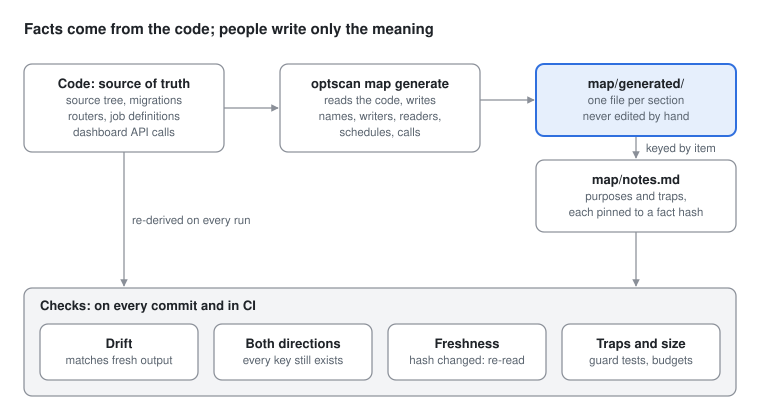

# Design: A Self-Verifying Project Map

| | |
|---|---|
| Status | Implemented and in use |
| Owner | Dominick |
| Scope | One repository: 124 modules, 22 tables, 32 routes, 21 dashboard files, 8 scheduled jobs, 28 commands, 7 caches |
| Source | `docs/design/project-map.md` in the repository; the PDF is built from it |

## Summary

The repository keeps a map of its own wiring: where data comes from, what writes and
reads each table, what each route reaches, which screen calls which route, and what runs
unattended. The facts in the map are generated from the code and checked against it on
every commit. People write only what the code cannot say about itself, such as why a
table exists and which lookups have caused defects, and each of those notes is pinned to
the facts it describes, so it is flagged for review the moment its wiring changes.

The result is a map an AI assistant (or a returning engineer) can trust without
re-deriving the system from source, which saves the tokens and time that re-derivation
costs and removes the wrong guesses it produces.

## Problem

The repository is built mostly through an AI coding assistant that keeps no state
between sessions. Without a map, every session begins by reconstructing the wiring one
search at a time. That reconstruction is expensive, varies between sessions, and is
where defects come from: a guess made from partial evidence looks exactly like a fact.

Two failure classes matter most:

- **A path that skips an input every other path supplies.** The code runs, produces
  plausible output, and is wrong.
- **A lookup that reads the right kind of data from the wrong source.** It silently
  covers a fraction of what it should.

A hand-written map helps with the first problem and does nothing for the second: if it
is wrong, it is confidently wrong, and nothing notices when it drifts.

## Goals

1. Answer routine wiring questions from the map, without searching the source.
2. Every factual claim in the map (a name, a writer, a reader, a schedule, a call) is
   produced from the code. Notes written by people are labelled as such.
3. No commit can land a map whose facts differ from the code, in either direction.
4. A note whose item has been rewired is flagged for review automatically.
5. Every known trap that can be expressed as a test is one.
6. A session reads a small index and opens only the part of the map its question needs.

## Non-goals

- **Checking that prose is true.** The design guarantees a note is re-read when its
  wiring changes, not that it is correct.
- **Catching every wiring bug.** The map works at the level of files, tables and routes.
  A wrong argument inside a correct flow is a job for a contract test (see Traps).
- **Recording history.** The map describes the system as it is. Why it came to be that
  way lives in the decision log.

## Design



### Layout

| File | Written by | Holds | Read |
|---|---|---|---|
| `MAP.md` | people | the upkeep rule, a system diagram, vendor limits, data directories, known gaps, and which file answers which question | every session (4.5 KB) |
| `map/generated/modules.md` | generator | every module and its docstring's first sentence | on demand |
| `map/generated/storage.md` | generator | every table, with the modules that write and read it | on demand |
| `map/generated/routes.md` | generator | every route: methods, router, what the endpoint reaches, which screens call it; every cache with its TTL and what clears it | on demand |
| `map/generated/views.md` | generator | every dashboard file and the API calls it makes | on demand |
| `map/generated/schedule.md` | generator | every scheduled job, its time, and what it runs | on demand |
| `map/generated/commands.md` | generator | every command and the modules its handler uses | on demand |
| `map/notes.md` | people | one note per table and job, plus traps and any item whose purpose is not obvious | on demand |

One generated file per section keeps diffs small and makes merge conflicts trivial: a
conflict in a generated file is resolved by regenerating it, never by hand.

### The generator

`optscan map generate` (`src/optscan/repomap.py`) reads each fact from its source of
truth:

| Fact | Source of truth | How |
|---|---|---|
| Modules and purposes | the source tree | each file's docstring, first sentence |
| Tables | the migrations | apply them to a scratch database and list the tables |
| Table writers and readers | the SQL in the source | scan string literals (not docstrings) for INSERT, UPDATE, DELETE, REPLACE, FROM and JOIN against the table names |
| Routes and what they reach | the routers | each route's endpoint, and every project function it reaches, following helpers in the same router |
| Caches | the dependency module | each cache, the TTL constants used where it is filled, the functions that clear it |
| Screen-to-route calls | the dashboard source | each file's calls through the API client, and any route fetched directly, matched to routes by method and path |
| Schedule | the job definitions | each job at its shipped default time |
| Commands | the CLI | each command's handler and the modules it imports |

Output is sorted and deterministic, so the same code always produces byte-identical
files. Anything the scanner cannot resolve (a table name built at run time, a client call
that matches no route) is listed in the generated file rather than dropped, and the map
test caps how many there may be. Generated files also surface facts nobody wrote down,
such as an API route that no screen calls.

### Notes

Each note names one item by its generated key, for example `table:daily_condition`, and
carries a hash of that item's facts:

```
### table:daily_condition
fact: 65799ccff487
Per-symbol daily gamma regime and indicators, recorded forward by `optscan conditions`.
No vendor sells historical per-strike open interest, so this record is the only gamma
history there will ever be.
```

The hash covers the item's wiring (its writers and readers, its calls, its schedule),
not its source file. A note is flagged when the thing it describes is rewired, and left
alone by an unrelated edit to the same file. That keeps review rare enough that nobody
learns to re-stamp without reading. After re-reading a flagged note,
`optscan map stamp <key>` records the current hash.

Every table and every scheduled job must have a note. A module needs none: its purpose
is its docstring.

### Traps

A trap is a lookup that has caused a defect. Each one is a note pinned to the test that
guards it:

```
### trap:scorer-without-iv-history
test: tests/test_traps.py::test_every_scorer_call_states_its_iv_history
```

Traps no static test can catch, such as a vendor limitation, say `test: none`. A new
trap is accepted as prose only after someone has asked whether it can be a test.

| Failure class | Guard |
|---|---|
| A scoring path omits an input every other path supplies | every call to the scorer must pass that input, or pass `None` explicitly |
| Volatility history read through the price source | no function may call the IV loader and the price-source lookup together |
| A study silently runs on a fraction of its symbols | the study harness raises when more than half the requested symbols never reach the test |

### Checks

`tests/test_map.py`, `tests/test_traps.py` and `optscan map check` enforce:

| Check | Fails when |
|---|---|
| Drift | a committed generated file differs from what the code produces now |
| Served routes | the running app serves a route the generator did not find |
| Coverage | a table or scheduled job has no note |
| Both directions | a note names an item that no longer exists, or a hand-written file names a file path that does not exist |
| Freshness | a note's recorded hash differs from its item's current facts |
| Pinning | a note has neither a fact hash nor a test |
| Traps | a trap names a test that does not exist, or a trap test fails |
| Index | `MAP.md` does not point at every generated file |
| Size | `MAP.md` exceeds 6 KB or the notes exceed 10 KB |
| Resolution | SQL names a table at run time, or a dashboard call matches no route |

Every failure message names what is wrong and the one command that fixes it.

### Where the checks run

| Stage | Runs |
|---|---|
| Pre-commit hook | lint and format; the full suite on Python changes; `optscan map check` on every commit, since a dashboard file or a note can change the map without touching Python |
| CI on every push (Windows) | lint, format, `optscan map check`, and the full suite |

The hook gives fast feedback; CI is the enforcement nobody can skip from a laptop.

## Operating it

| When | Do |
|---|---|
| Starting a session | read `MAP.md`; open the generated file or notes the question needs |
| After any wiring change | `optscan map generate`, commit the result with the change |
| A note is reported stale | re-read it against the generated file, correct it, `optscan map stamp <key>` |
| Adding a table or job | add its note, then stamp it |
| A lookup causes a defect | write the guard test, then add a `trap:` note pointing at it |
| Checking quickly | `optscan map check` |

Ownership is the change author's: whoever changes the wiring regenerates the map in the
same commit. There is no separate map owner.

## Measuring it

The goal is fewer source searches, so that is what is measured. The assistant keeps a
transcript of every session with each tool call recorded, which needs no new
instrumentation.

| Metric | Definition |
|---|---|
| Searches before first edit | source-search and file-read calls before the session's first code edit, median per session |
| Tokens before first edit | tokens consumed before the first code edit, median per session |
| Repeated derivations | the same file read more than twice in one session |
| Wrong-wiring defects | defects traced to a wrong map fact or a wrong lookup |
| Freshness precision | of the notes flagged stale, how many were actually wrong on review |

Compare two-week windows, using the median so one long session does not dominate. If
freshness precision is low, the fact hash is too broad and should be narrowed.

## Alternatives considered

| Alternative | Advantage | Why not |
|---|---|---|
| The assistant searches the source each session | no upkeep | the cost this design removes; answers vary and guesses become defects |
| A hand-written map with a completeness test | simple; holds meaning | checks names, not facts: a wrong writer or reader passes |
| A fully generated map | facts cannot drift | no purposes and no traps: names without meaning |
| Generated facts with pinned hand-written notes (chosen) | facts cannot drift; meaning is kept and re-read when its wiring changes | a generator and a stamping command to maintain |
| A wiki outside the repository | richer formatting | not versioned or reviewed with the code |

## Risks

| Risk | Mitigation |
|---|---|
| The SQL scanner misses a writer or reader | unresolved SQL is listed, and its count is capped by a test |
| Freshness fires so often that people re-stamp without reading | the hash covers facts, not files; precision is measured |
| A generated file is edited by hand | the drift check fails on the next commit and names the command to run |
| A note is wrong when written | not machine-checkable; notes are short and reviewed in the same diff as the code |
| The map grows until reading it costs what it saves | size budgets on the hand-written files; generated files are read only on demand |

## Adoption checklist

1. List the questions readers arrive with, and the source of truth that answers each.
2. Write a generator that extracts each fact from its source of truth, deterministically.
3. Split the map: a short index read every session, generated files read on demand,
   and a notes file for meaning.
4. Pin each note to a hash of its item's facts, with a command to re-stamp it.
5. Add tests for drift, both directions, freshness, size and unresolved extraction.
6. Turn every trap that can be a test into one, and point its note at the test.
7. Prove each check fails: add a dummy module, rewire a table, rename a note key, remove
   a guarded argument. Watch each test fail, then restore.
8. Run the checks on every commit and in CI.
9. Keep every document in the present tense. History belongs in the decision log; in a
   document an assistant loads, it is context that has to be read and set aside.
